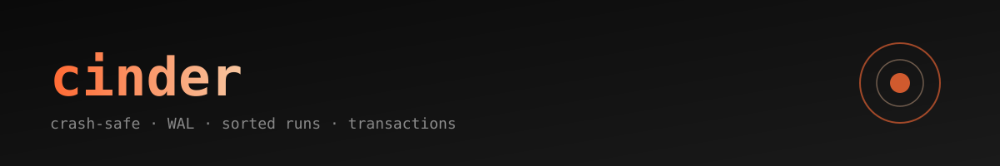

# cinder

Crash-safe embedded SQL database. WAL, sorted runs, secondary indexes, transactions. Pure Rust. Zero dependencies.

Nothing is durable until the WAL record has been written and `sync_data` has returned. Recovery stops on the first CRC mismatch or truncated frame and never returns a partial record.

## What it is

- **WAL** — length-prefixed CRC32 frames, one `sync_data` per durable mutation
- **Memtable** — ordered `BTreeMap` per table
- **Sorted runs** — immutable SSTables flushed from the memtable
- **Catalog** — tables, typed columns, secondary index declarations
- **Transactions** — `BEGIN` / `COMMIT` / `ROLLBACK` with buffered writes
- **SQL subset** — `CREATE TABLE`, `CREATE INDEX`, `INSERT`, `SELECT`, `UPDATE`, `DELETE`

No network. No external crates. One process, one directory.

## Quick start

```rust
use cinder::Database;

let mut db = Database::open("data")?;
db.execute("CREATE TABLE users (id INTEGER PRIMARY KEY, name TEXT, email TEXT)")?;
db.execute("CREATE INDEX idx_email ON users (email)")?;
db.execute("INSERT INTO users VALUES (1, 'alice', 'a@x.com')")?;
db.execute("BEGIN")?;
db.execute("INSERT INTO users VALUES (2, 'bob', 'b@x.com')")?;
db.execute("COMMIT")?;

let rows = db.query("SELECT id, name FROM users WHERE id = 1")?;
assert_eq!(rows[0][1].to_string(), "alice");
```

```sh
cargo test
cargo run
cargo run -- /tmp/cinder-demo
```

## Rules

- Primary key is required (first `INTEGER` column becomes primary key if none is marked).
- A batch of writes inside a transaction is applied atomically on `COMMIT`.
- `ROLLBACK` discards the buffer; the WAL records the abort.
- After a crash, open again — the WAL is replayed, incomplete frames are ignored.
- `checkpoint()` flushes memtables and truncates the WAL once the data is in sorted runs.

## What it is not

Not a server. Not multi-writer. Not a full SQL engine. No joins, no aggregates, no `ORDER BY` yet. Secondary indexes are declared and persisted; lookup still scans for the demo scale. Compaction is a soft limit on the number of runs.

## Build

```sh
cargo test
cargo build --release
```

## License

MIT. Copyright 2026 vantacorehq.
